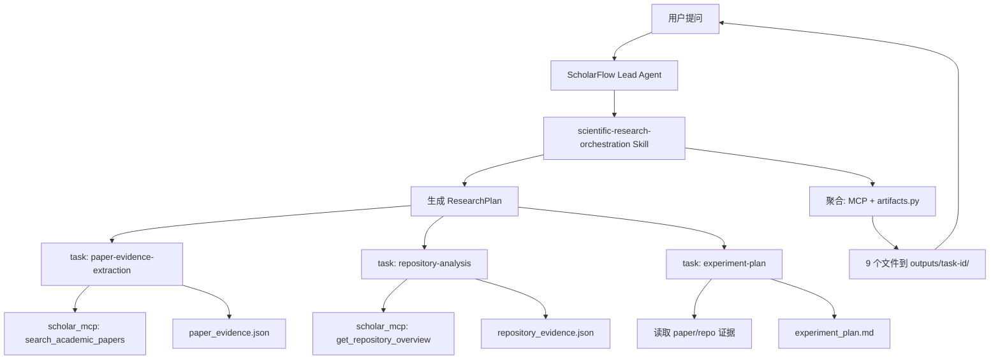

# ScholarFlow Agent 开发说明

> 基于 ScholarFlow 二次开发的科研调研 Agent 扩展  
> 版本：Phase 0–7 骨架已完成  
> 最后更新：2026-07-12

---

## 1. 产品定位

**ScholarFlow** 面向 CV/ML/Agent 研究人员，解决：

- 文献调研（arXiv 等）
- 开源代码 landscape 分析（GitHub）
- 实验方案设计
- 结构化、可追溯的研究产物输出

**不是**一个新的 Agent 框架；**是** ScholarFlow 上的领域扩展包。

---

## 2. 与 ScholarFlow 的关系

| ScholarFlow 组件 | ScholarFlow 如何使用 |
|---------------|---------------------|
| Lead Agent | 接收用户请求，加载 orchestration Skill |
| `task` 工具 | 编排 Skill 委派 3 路 Sub-Agent（最多 3 并发） |
| Skills 系统 | 4 个 custom Skill 定义工作流 |
| MCP 系统 | `scholar_mcp` 提供 arXiv/GitHub/校验/报告工具 |
| Sandbox | 产物写入 `/mnt/user-data/outputs/<task-id>/` |
| Memory / 流式 | 完全复用 ScholarFlow，未修改 |

**设计约束：** 不改 LangGraph 核心、不重写 Lead Agent。

---

## 3. 四个「角色」（实为 4 个 Skill）

### 3.1 编排者 — `scientific-research-orchestration`

**触发词：** research survey、literature review、technical research report、ScholarFlow

**五阶段工作流：**

1. **Plan** — 写 `ResearchPlan` → `research_plan.json`
2. **Delegate** — 并行委派文献 / 仓库 / 实验三路
3. **Review** — 交叉验证，写 `evidence_review.json`
4. **Aggregate** — 调 MCP + Python 生成矩阵和报告
5. **Deliver** — 向用户交付 9 件套摘要

**文件：** `skills/custom/scientific-research-orchestration/SKILL.md`

### 3.2 文献研究员 — `paper-evidence-extraction`

- 调 `search_academic_papers` 搜 arXiv
- 映射为 `PaperEvidence` 结构
- 输出 `paper_evidence.json`
- **禁止** 编造未出现在摘要/正文中的结论

**文件：** `skills/custom/paper-evidence-extraction/SKILL.md`

### 3.3 仓库分析师 — `repository-analysis`

- 调 `get_repository_overview` 查 GitHub
- 映射为 `RepositoryEvidence`
- 输出 `repository_evidence.json`

**文件：** `skills/custom/repository-analysis/SKILL.md`

### 3.4 实验设计师 — `experiment-plan`

- 基于 paper + repo 证据写假设、基线、指标、消融
- 输出 `experiment_plan.md`

**文件：** `skills/custom/experiment-plan/SKILL.md`

---

## 4. 工具层 — `scholar_mcp`

**位置：** `extensions/scholar_mcp/`  
**注册：** `extensions_config.json` → `mcpServers.scholar_mcp`

| 工具 | 作用 |
|------|------|
| `search_academic_papers` | arXiv 检索 |
| `get_repository_overview` | GitHub 元数据 + README 摘要 |
| `extract_uploaded_paper` | 用户上传文件提取 |
| `generate_research_matrix` | paper/repo CSV 矩阵 |
| `validate_evidence_schema` | Pydantic 校验 JSON |
| `build_research_report` | 合成 Markdown 报告 |
| `list_task_artifacts` | 列出虚拟产物路径 |
| `assemble_task_artifacts` | 一次生成全部 9 文件内容 |

**共享 Schema 包：** `backend/packages/harness/scholarflow/scholar/`（MCP 通过 `PYTHONPATH` 引用）

Docker 环境下由 `docker-compose-dev.yaml` 注入：

- `SCHOLAR_MCP_PYTHON` — gateway venv 中的 Python
- `SCHOLAR_PYTHONPATH` — harness + scholar_mcp 包路径

---

## 5. 数据层 — 9 类固定产物

每个 task 在 `/mnt/user-data/outputs/<task-id>/` 下输出：

| # | 文件名 | 类型 | Schema / 说明 |
|---|--------|------|---------------|
| 1 | `research_report.md` | Markdown | 人类可读总报告 |
| 2 | `research_plan.json` | JSON | `ResearchPlan` |
| 3 | `paper_evidence.json` | JSON | `PaperEvidenceCollection` |
| 4 | `paper_matrix.csv` | CSV | 论文对比矩阵 |
| 5 | `repository_evidence.json` | JSON | `RepositoryEvidenceCollection` |
| 6 | `repository_matrix.csv` | CSV | 仓库对比矩阵 |
| 7 | `experiment_plan.md` | Markdown | 实验方案 |
| 8 | `evidence_review.json` | JSON | `ReviewFindingCollection` |
| 9 | `sources.json` | JSON | `SourceCollection` |

**Schema 定义：** `backend/packages/harness/scholarflow/scholar/models.py`  
**聚合入口：** `scholarflow/scholar/artifacts.py` → `build_task_artifacts()`

---

## 6. 架构图



---

## 7. 代码目录地图

```
scholarflow/   # 本地工作区目录名建议：ScholarFlow_project（勿写成 deepflow）
├── backend/packages/harness/scholarflow/scholar/   # Python 核心库
│   ├── models.py          # Pydantic Schema
│   ├── matrix.py          # CSV 矩阵生成
│   ├── aggregation.py     # 去重、合并 sources
│   ├── report.py          # Markdown 报告
│   ├── artifacts.py       # 九件套聚合
│   ├── experiment_plan.py # 实验方案 Markdown 渲染
│   ├── validation.py      # JSON 校验
│   └── paths.py           # 虚拟输出路径
├── extensions/scholar_mcp/                      # MCP Server
│   ├── scholar_mcp/server.py
│   └── scholar_mcp/clients/arxiv.py, github.py
├── skills/custom/                               # 4 个 Agent Skill
│   ├── scientific-research-orchestration/
│   ├── paper-evidence-extraction/
│   ├── repository-analysis/
│   └── experiment-plan/
├── evaluation/                                  # 离线评测
│   ├── tasks.json
│   ├── metrics.py
│   └── run_eval.py
├── docs/scholar-flow/                           # 文档
│   ├── agent-guide.md     # 本文档
│   ├── design.md
│   ├── data-contracts.md
│   ├── setup.md
│   └── baseline.md
├── extensions_config.json                     # MCP 注册（本地，gitignore）
└── config.yaml                                # 含 deepseek-chat 模型（本地，gitignore）
```

---

## 8. 分阶段交付清单

| Phase | 交付物 | 状态 |
|-------|--------|------|
| 0 | ScholarFlow 基线环境、`baseline.md` | ✅ |
| 1 | Pydantic Schema、设计/契约文档、Schema 单测 | ✅ |
| 2 | `extensions/scholar_mcp`、MCP 单测、`extensions_config` 注册 | ✅ |
| 3 | 4 个 `skills/custom/` Skill | ✅ |
| 4–5 | `artifacts.py` 聚合、编排脚本 `aggregate_artifacts.py` | ✅ |
| 6 | `evaluation/` 20 任务 + 指标 | ✅ |
| 6+ | **E2E Benchmark**（10 case、质量层、硬门槛、对比脚本） | ✅ |
| 7 | README、setup、verify 脚本 | ✅ |
| 7+ | **resume-highlights / benchmark / production** 文档 | ✅ |
| — | E2E 真实对话验收 | ⏳ 需配置 `DEEPSEEK_API_KEY` |

---

## 9. 一次完整请求的数据流

**用户输入示例：**

> 使用 scientific-research-orchestration，调研 RAG 架构及相关 GitHub 实现，task id: `rag-test-001`

**执行顺序：**

1. Lead Agent 匹配 orchestration Skill
2. 生成 `ResearchPlan`（`task_id=rag-test-001`）
3. Sub-Agent A：`paper-evidence-extraction` → arXiv → `paper_evidence.json`
4. Sub-Agent B：`repository-analysis` → GitHub → `repository_evidence.json`
5. Sub-Agent C：`experiment-plan` → `experiment_plan.md`
6. 编排者 Review → `evidence_review.json`
7. MCP `generate_research_matrix` → 两个 CSV
8. MCP `assemble_task_artifacts` 或 Python 脚本 → 其余文件
9. 用户收到摘要 + 9 文件链接

---

## 10. 测试与验收

| 测试 | 命令 | 预期 |
|------|------|------|
| Schema 单测 | `cd backend && uv run pytest tests/test_scholar_schemas.py -q` | 14 passed |
| MCP 单测 | `cd extensions/scholar_mcp && uv sync --group dev && uv run pytest -q` | 5 passed |
| E2E Benchmark | `cd backend && uv run python ../evaluation/run_benchmark.py --mode golden` | 10 tasks，见 `reports/latest.md` |
| 真实 E2E 评分 | 产物放入 `evaluation/results/<task-id>/` 后 `--mode artifacts` | E2E pass rate |
| 优化对比 | `uv run python ../evaluation/compare_runs.py baseline.json optimized.json` | before/after |
| 一键自检 | `bash scripts/verify_scholarflow.sh` | 健康检查 + 上述测试 |
| E2E 对话 | 配置 Key 后在 http://localhost:2026 发调研请求 | 9 个产物齐全 |

---

## 11. 启用步骤（摘要）

1. 在 `.env` 填写 `DEEPSEEK_API_KEY`（及可选 `GITHUB_TOKEN`）
2. 确认 `extensions_config.json` 中 `scholar_mcp.enabled: true`
3. 重启 Docker：`docker compose -p scholarflow-dev -f docker/docker-compose-dev.yaml up -d --force-recreate gateway`
4. 访问 http://localhost:2026 发送调研任务

详细步骤见 [`setup.md`](setup.md)。

---

## 12. 当前限制

- LLM Key 未配置时无法实际对话
- 未改 ScholarFlow 前端（无专用 Research Workspace UI）
- arXiv/GitHub 依赖公网；GitHub 建议配 `GITHUB_TOKEN`
- Skill 行为依赖 LLM 遵循 SKILL.md，非硬编码状态机

---

## 13. 建议学习顺序

1. 读 [`design.md`](design.md) — 懂架构
2. 读 `backend/packages/harness/scholarflow/scholar/models.py` — 懂数据结构
3. 读 4 个 `skills/custom/*/SKILL.md` — 懂 Agent 行为
4. 读 `extensions/scholar_mcp/scholar_mcp/server.py` — 懂工具
5. 读 `backend/packages/harness/scholarflow/scholar/artifacts.py` — 懂聚合
6. 配 Key → 发一条真实请求 → 检查 9 个产物

---

## 14. 相关文档索引

| 文档 | 用途 |
|------|------|
| [`agent-guide.md`](agent-guide.md) | 本文档 — Agent 全貌 |
| [`design.md`](design.md) | 架构设计与 Phase 地图 |
| [`data-contracts.md`](data-contracts.md) | 9 类产物字段说明 |
| [`setup.md`](setup.md) | 启用与故障排查 |
| [`baseline.md`](baseline.md) | Phase 0 环境基线 |
| [`resume-highlights.md`](resume-highlights.md) | **简历 bullet 与量化模板** |
| [`benchmark.md`](benchmark.md) | E2E Benchmark 方法论 |
| [`production.md`](production.md) | 准生产工程清单 |
| [`../../extensions/scholar_mcp/README.md`](../../extensions/scholar_mcp/README.md) | MCP 工具说明 |
