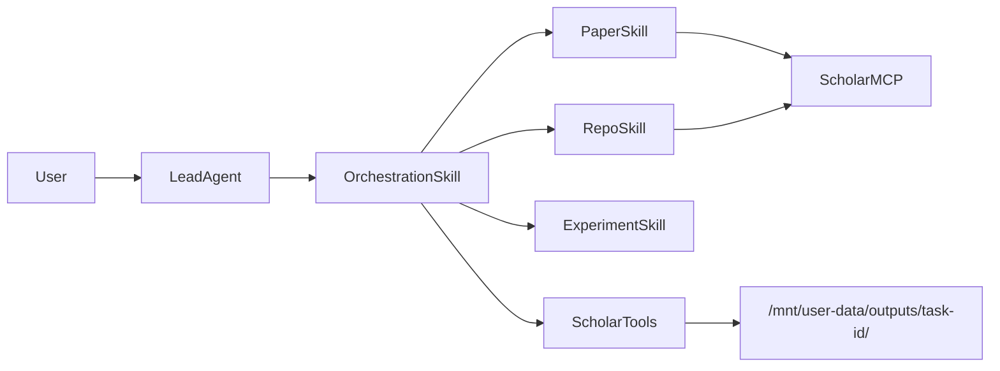

# ScholarFlow design

ScholarFlow extends ScholarFlow without modifying the Lead Agent or LangGraph core. Research workflows are expressed as **custom Skills** plus an independent **MCP server** (`extensions/scholar_mcp/`).

## Goals

- Multi-agent scientific and technical research (papers, code, experiments)
- Structured artifacts with Pydantic validation
- Deterministic aggregation (matrices, dedupe, reports)
- Evaluation harness for regression testing

## Architecture

## Roles (Skills, not graph nodes)

| Skill | Responsibility |
|-------|----------------|
| `scientific-research-orchestration` | Plan, delegate, aggregate nine artifacts |
| `paper-evidence-extraction` | arXiv / literature evidence → `PaperEvidence` |
| `repository-analysis` | GitHub repos → `RepositoryEvidence` |
| `experiment-plan` | Synthesize `ExperimentPlan` from evidence |

Delegation uses ScholarFlow `task(general-purpose)` with skill-specific prompts and references.

## Output contract

Each task writes nine files under `/mnt/user-data/outputs/<task-id>/`:

1. `research_report.md`
2. `research_plan.json`
3. `paper_evidence.json`
4. `paper_matrix.csv`
5. `repository_evidence.json`
6. `repository_matrix.csv`
7. `experiment_plan.md`
8. `evidence_review.json`
9. `sources.json`

Schemas live in `backend/packages/harness/scholarflow/scholar/models.py`.

## Extension points

- `extensions_config.json` — register `scholar_mcp` MCP server
- `skills/custom/` — four ScholarFlow skills (git-tracked via `.gitignore` exceptions)
- `evaluation/` — batch tasks and metrics

## Non-goals (Phase 1–7)

- No Lead Agent graph rewrite
- No mandatory AioSandbox (LocalSandbox OK for dev)
- No paid API integrations beyond public arXiv / GitHub

## Phase map

| Phase | Deliverable |
|-------|-------------|
| 0 | ScholarFlow baseline (done) |
| 1 | Schemas + design docs |
| 2 | `scholar_mcp` MCP + tests |
| 3 | Four custom skills |
| 4–5 | Python tools + orchestration references |
| 6 | `evaluation/` harness |
| 7 | README and operator docs |
