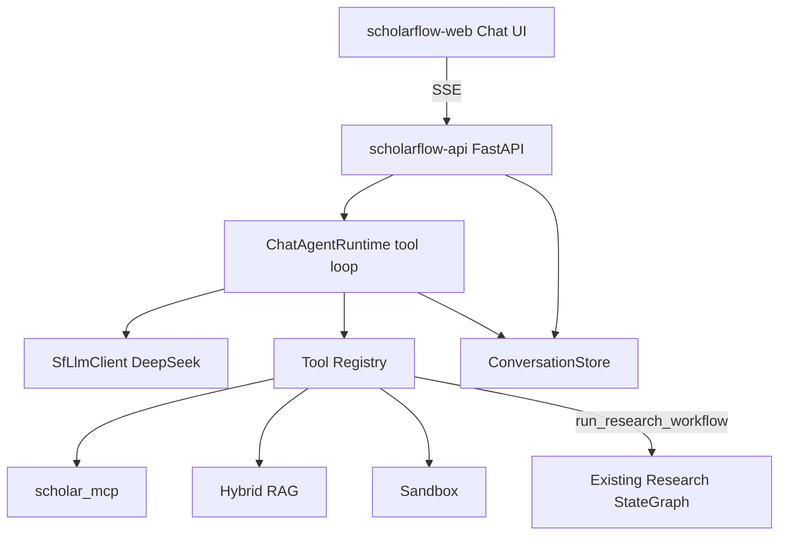

# ScholarFlow 阶段 8：对话式多 Agent 技术方案（设计稿）

> **本轮边界：** 方案设计与代码落点核查；**不**进行大规模改码。  
> **前提审计：** Vite+FastAPI 科研主链路基本不调用 Chat LLM；DeepSeek Key 属 ScholarFlow 配置；前端为任务工作台。  
> **目标：** ChatGPT 风格多轮对话 + 真实 LLM 工具闭环，同时保留阶段 1–7 工作流 / MCP / RAG / Sandbox / 评测。

---

## 0. 当前代码结构与可复用能力

### 0.1 ScholarFlow 独立栈（当前在跑）

| 模块 | 路径 | 现状 |
|------|------|------|
| FastAPI 入口 | `apps/scholarflow-api/scholarflow_api/app.py` | `/api/v1/tasks`、artifacts、sandbox、mcp/tools、health |
| 配置 | `scholarflow_api/config.py` | **不读** Chat API Key；仅 artifacts/timeout/port |
| 科研 LangGraph | `graph/workflow.py` + `nodes.py` | **预设节点图**（确定性 + fixture/MCP） |
| MCP Client | `mcp/client.py` | stdio → `extensions/scholar_mcp` |
| RAG | `scholarflow/scholar/rag/*` | 本地 embedding + 模板拼答案（非 Chat LLM） |
| 任务持久化 | `services/task_store.py` | 内存 + `task_state.json` |
| 产物 | `services/artifact_store.py` | 每 task 九件套 |
| 前端 | `apps/scholarflow-web` | 任务提交工作台，无会话/SSE |
| 依赖 | `apps/scholarflow-api/pyproject.toml` | 仅 fastapi/uvicorn/pydantic |

### 0.2 同仓可复用但未接入 ScholarFlow API 的能力

| 能力 | 路径 | 说明 |
|------|------|------|
| DeepSeek 封装 | `ScholarFlow/models/patched_deepseek.py` | `PatchedChatDeepSeek`；`lc_secrets` → `DEEPSEEK_API_KEY` |
| 模型工厂 | `ScholarFlow/models/factory.py::create_chat_model` | 读 ScholarFlow `config.yaml`（**阶段 8 不整份复制**） |
| LangChain Agent 模式 | `ScholarFlow/agents/lead_agent`、`create_agent` | 参考实现；ScholarFlow 用**轻量自建** tool-loop，避免拖入整套 ScholarFlow |
| venv 已装 | backend `.venv` | `langchain_deepseek` / `langgraph` / `langchain_core` 可 import |

### 0.3 配置审计（脱敏）

| 项 | 结果 |
|----|------|
| `.env` `DEEPSEEK_API_KEY` | **SET**（不回显） |
| `.env` `GITHUB_TOKEN` | **SET**（MCP GitHub） |
| `config.yaml` | `deepseek-chat` + `PatchedChatDeepSeek` + `$DEEPSEEK_API_KEY` |
| ScholarFlow API 进程 | **当前不加载**该 Key 到聊天链路 |

---

## 1. 目标架构



**双轨并存：**

1. **Chat Agent（新建）**：真实 LLM + `bind_tools` 自主循环。  
2. **Research Workflow（已有）**：作为工具 `run_research_workflow` 被委托，不在聊天环内重写九产物。

**禁止：** 把确定性节点、fixture、模板拼装称为「自主 LLM Agent」。

---

## 2. DeepSeek 接入方案

### 2.1 ScholarFlow 独立 Client（不复制 ScholarFlow yaml）

拟新增目录：`apps/scholarflow-api/scholarflow_api/llm/`

| 文件 | 职责 |
|------|------|
| `settings.py` | 读环境变量；校验 key 存在；**永不 log 明文** |
| `client.py` | `build_chat_model()` |
| `guards.py` | timeout / retries / max_tokens |

**环境变量（仅后端进程）：**

| 变量 | 用途 | 建议默认 |
|------|------|----------|
| `DEEPSEEK_API_KEY` | 复用现有 `.env`，**不改 key** | 必填方可启用 chat |
| `SCHOLARFLOW_LLM_MODEL` | 模型 ID | `deepseek-chat` |
| `SCHOLARFLOW_LLM_BASE_URL` | OpenAI 兼容 Base URL | DeepSeek 官方默认；可覆盖 |
| `SCHOLARFLOW_LLM_TIMEOUT` | 单次超时 | 60–90s |
| `SCHOLARFLOW_LLM_MAX_RETRIES` | 重试 | 2 |
| `SCHOLARFLOW_CHAT_MAX_TOOL_ITERS` | 工具环上限 | 8 |

**注入方式：** 修改 `scripts/start_scholarflow_api.ps1`：启动 uvicorn **前**将仓库根 `.env` 载入**当前 PowerShell 进程环境**（过滤并拒绝写入任何 `VITE_*KEY*`）。前端构建变量中**禁止**出现 API Key。

**实现选择（按优先级）：**

1. `langchain_deepseek.ChatDeepSeek(model=..., api_key=os.environ["DEEPSEEK_API_KEY"], ...)`  
2. 或 `ScholarFlow.models.patched_deepseek.PatchedChatDeepSeek`（多轮 reasoning 更稳）

**验收：** 真实 `ainvoke`/`invoke` 一次（非 mock）。失败 → chat 接口 503，**不**静默改模板回答。

### 2.2 明确排除

- Embedding / Cross-Encoder / BM25：**不是**对话模型。  
- 不修改、不打印、不提交现有 Key。

---

## 3. 对话 Agent Runtime（真实工具闭环）

### 3.1 图设计

拟：`scholarflow_api/chat/agent.py`

- State：`messages` + `conversation_id` + `iter` + `traces`
- 节点：`llm_agent`（`model.bind_tools(tools)`）→ 条件边 → `ToolNode` → 回边
- 终止：无 `tool_calls` / `iter >= MAX` / 取消 / 不可恢复错误

这才是「模型推理 → 选工具 → 执行 → 再推理」；**不是**固定 if/else 调度。

### 3.2 工具表（复用现有）

| Tool | 包装对象 | 模型可见输出 |
|------|----------|--------------|
| `search_papers` | `adapters.fetch_papers_via_mcp` | 结构化论文摘要 + evidence_id/url |
| `analyze_github_repo` | `fetch_repo_via_mcp` | 仓库摘要 |
| `scholar_rag_query` | `rag_answer` | answer + evidence + need_mcp_fallback |
| `run_research_workflow` | `run_research_workflow` / ResearchRuntime | task_id、status、产物摘要 |
| `execute_sandbox_python` | 现有 sandbox policy | stdout/stderr/status（受限） |
| `list_task_artifacts` | artifact_store | 文件列表 |

每个工具：Pydantic args、超时、错误结构化、写入 `tool_call_trace`。

### 3.3 多 Agent / 子能力边界

| 名称 | 是否 Chat LLM | 输入 | 输出 | 工具权限 |
|------|---------------|------|------|----------|
| Lead Chat Agent | **是** | 用户消息 + 历史 | 最终回复 + traces | 上表全部（可按会话策略裁剪） |
| 论文能力 | 否（MCP 工具） | query | paper evidence | 仅 search_papers |
| 仓库能力 | 否（MCP 工具） | repo | repo evidence | 仅 analyze_github_repo |
| 综合科研 | 否（委托现有图） | question + kind | task + 9 产物 | run_research_workflow |
| RAG | 否（检索拼装） | question | 引用答案/拒答 | scholar_rag_query |
| Review/实验 | 随 workflow 工具 | — | 图内确定性节点 | **勿标为 LLM Sub-Agent**，除非后续单独加 LLM 审查 |

主 Agent **按需**选工具，不强制每次跑满四节点。

---

## 4. 会话与记忆

建议根：`$SCHOLARFLOW_TASKS_DIR/../conversations` 或同级 `conversations/`：

```
conversations/{conversation_id}/meta.json
conversations/{conversation_id}/messages.jsonl
```

**字段：** `conversation_id`, `message_id`, `role`, `content`, `created_at`, `tool_call_trace`, `related_task_id?`, `evidence_refs[]`

**三分离：**

1. 会话消息（本设计）  
2. 科研任务状态（现有 TaskStore）  
3. 长期 RAG 产物/索引（现有 artifacts + rag_index）

验收：重启 API 后历史可恢复；会话 A/B 隔离；消息顺序稳定。

---

## 5. Chat API 与 SSE

对齐 `/api/v1` 风格：

| Method | Path | 说明 |
|--------|------|------|
| POST | `/api/v1/conversations` | 创建 |
| GET | `/api/v1/conversations` | 列表 |
| GET | `/api/v1/conversations/{id}/messages` | 历史 |
| POST | `/api/v1/conversations/{id}/messages` | 发消息；SSE 当 `Accept: text/event-stream` |
| POST | `/api/v1/conversations/{id}/stop` | 停止 |
| GET | `/api/v1/conversations/{id}/tasks` | 关联科研任务 |

**SSE 事件（真实过程）：** `token` | `tool_start` | `tool_end` | `workflow_progress` | `error` | `done`  

禁止：先算完全文再切片伪装流式。

**保留：** `/api/v1/tasks`、artifacts、sandbox、health；health 增加 `llm_configured: bool`（无 key 内容）。

---

## 6. 前端改造

`apps/scholarflow-web`：

- **Chat Tab（默认）**：会话列表、新建、气泡、多轮、SSE、Markdown、工具轨迹、证据链接、产物入口、停止/重试  
- **工作台 Tab（保留）**：现有任务提交 UI，不删除阶段 1–7 能力  
- 品牌统一 ScholarFlow  
- API 模块：`src/api/chat.ts`；**零**密钥进入前端

---

## 7. 安全与资源

| 项 | 要求 |
|----|------|
| Key | 仅后端；禁 `VITE_*KEY*`；日志脱敏 |
| 工具 | Schema 校验；超时；最小权限；记录 trace |
| Sandbox | 仍走现有 policy；禁止模型直 exec 宿主机 |
| 循环 | max tool iters；可检测重复同参调用 |
| 8GB | 本机 Vite+API；不启 scholarflow Docker；不下载大型本地 Chat 模型 |
| Git | 不 reset/clean；不改现有 Key |

---

## 8. 拟新增/修改文件清单

**新增：**

- `scholarflow_api/llm/{__init__,settings,client,guards}.py`
- `scholarflow_api/chat/{__init__,agent,tools,store,events,router}.py`
- `tests/test_chat_store.py`, `test_chat_agent_mock.py`, `test_chat_llm_live.py`（live mark）
- `apps/scholarflow-web/src/chat/*`, `api/chat.ts`
- 实现后：`docs/scholarflow-phase8.md`（验收记录）

**小改：**

- `app.py` 挂载 router；health 字段  
- `scripts/start_scholarflow_api.ps1` 加载 `.env`  
- 前端入口增加 Chat / 工作台切换  

**不改：** ScholarFlow 密钥与整份 yaml 复制；冻结评测集与历史报告。

---

## 9. 分阶段实现计划与验收

| 阶段 | 内容 | 验收 |
|------|------|------|
| **8.0** | LLM Client + 真实 ping | 真实 DeepSeek 响应；key 不上前端 |
| **8.1** | ConversationStore + REST | 持久化、隔离、顺序 |
| **8.2** | Tool-calling Agent | Mock 闭环；Live 自主选 ≥1 工具 |
| **8.3** | SSE | 含 tool_start/end 的真流式 |
| **8.4** | 委托 `run_research_workflow` | 综合任务出 task_id + 产物 |
| **8.5** | 前端 Chat + 保留工作台 | 多轮追问、证据、下载、停止 |
| **8.6** | 12 项评测 | mock/live 分报；不混称 |

**12 项测试映射：** 多轮 / 上下文追问 / 自主论文 / 自主 GitHub / 多工具连续 / 工具后再推理 / 委托工作流 / MCP 失败 / 拒答 / 会话持久化隔离 / SSE / max-iter 停止 —— live 项用 `@pytest.mark.live_llm`，无 key 则 skip。

---

## 10. 风险摘要

- DeepSeek 费用与限流 → 超时、iters、前端停止  
- 收紧工具后误调 → 系统提示 + 工具描述写清何时用 RAG vs 全量工作流  
- 与阶段 1–7 回归冲突 → 旧 API 保持；先跑旧测再跑 chat mock  
- 误把模板节点当 LLM → 文档与 UI 标注「LLM Agent」仅限 Lead Chat  

---

## 11. 等待确认

请确认是否按 **8.0 → 8.6** 开工，以及：

1. LLM 封装优先 **直接 ChatDeepSeek** 还是 **PatchedChatDeepSeek**？  
2. 首版工具集是否先上 **RAG + search_papers + run_research_workflow**（GitHub/Sandbox 第二批）？  
3. 前端默认落地 **Chat** 还是默认仍为工作台？

确认前**不**开始大规模实现。
